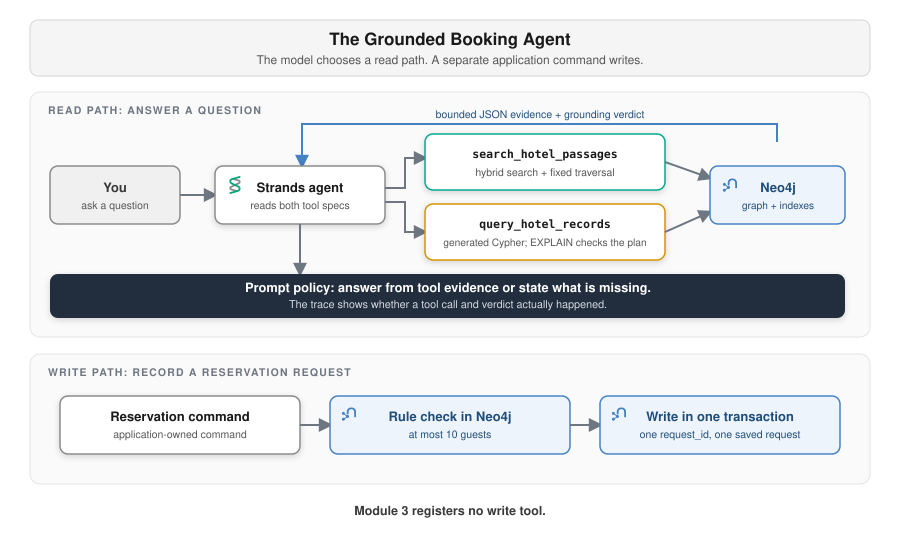

<style>
section {
  --marp-auto-scaling-code: false;
}

li {
  opacity: 1 !important;
  animation: none !important;
  visibility: visible !important;
}

/* Disable all fragment animations */
.marp-fragment {
  opacity: 1 !important;
  visibility: visible !important;
}

ul > li,
ol > li {
  opacity: 1 !important;
}
</style>

# The Grounded Booking Agent

**Lab:** Module 3, Notebook 3.1
`3.1_grounded_booking_agent.ipynb`

Module 2's GraphRAG read paths become two tools the agent can choose. The write path stays separate.

<!--
Module 2 compares GraphRAG retrieval patterns. Module 3 turns the hybrid
passage read and guarded record query into tools for one Strands agent.

This deck has two hinges. "Two Read Tools, One Boundary" shows the agent
routing between those tools by specification. "Writes Do Not Go Through the
Model" keeps the notebook's reservation command outside that agent.

Most agent talks cover the first half of this deck and stop. The reservation
half is where the workshop says something the room has probably not heard, so
protect the time for it. If you are running late, cut the ReAct slide, not the
write path.
-->

---

## What Is an Agent

A model with tools and a loop:

- **Perception:** it reads the question and the conversation so far
- **Reasoning:** it decides what it needs and which tool provides it
- **Action:** it calls the tool and gets a result back
- **Response:** it answers, or it loops again

The difference from a chatbot is the Action step. The model can reach your systems.

<!--
Say the last line as a warning, not a feature. Everything in this deck is about
what that reach is allowed to include.

A model that can call a search function is useful. A model that can call a
write function is a system where a wrong token becomes a row in a database.
"Writes Do Not Go Through the Model" is where that gets resolved.
-->

---

## The ReAct Loop

> Which Chicago hotel has both a spa and a swimming pool, what is its cancellation policy, and can I submit a booking request for four guests?

1. **Reason:** the filter needs records; the policy needs source wording
2. **Act:** call `query_hotel_records`, then `search_hotel_passages`
3. **Observe:** one result carries rows and Cypher; the other carries passages and linked facts
4. **Reason:** the evidence identifies the hotel and its policy. The hold needs a separate command
5. **Respond:** I answer the first two clauses from context, and I say the third needs a reservation

Each turn of the loop is one round trip to the model.

<!--
Step 2 is the routing lesson. One user question can need both evidence shapes,
and the system prompt explicitly permits more than one tool call.

The structured tool adds another Bedrock call inside the tool to generate
Cypher. The returned Cypher is visible so the participant can inspect what ran.
-->

---

## Overview of Strands Agents

```python
agent = Agent(
    model=BedrockModel(model_id=...),
    tools=list(READ_TOOLS),
    system_prompt=BASE_GROUNDING_PROMPT,
    hooks=[trace],
)
```

- **`Agent`** runs the loop and calls whichever tool the model selects
- **`BedrockModel`** connects it to Claude on Amazon Bedrock
- **`@tool`** builds a specification with a name, description, and input schema
- **The system prompt** states which facts the model may use and when it must abstain
- **`ToolTraceHook`** records the selected tool and its bounded result

The model selects a tool from the specifications that Strands provides.

<!--
The notebook prints the final tool specifications before building the agent.
The docstring supplies most of the description, but the model receives the
generated specification, not the raw Python source.

Names and descriptions matter because the model must distinguish source wording
from counts, averages, rankings, filters, and relationship questions.
-->

---

## Strands Is Model-Driven by Default

| Flow-first agent design | Strands agent loop |
|---|---|
| The developer defines the execution path | The developer defines the goal, model, and tools |
| Application code decides which step runs next | The model selects a tool, inspects the result, and decides whether to continue or respond |
| A new case often needs another branch | The loop can adapt within the prompt and tool boundaries |

**More control is optional:** a Strands Graph defines nodes and allowed transitions; a Workflow defines fixed task dependencies.

<!--
This is the central Strands design choice. The application supplies context and
capabilities. The model drives the loop by deciding which tool to call, how the
result changes its reasoning, and whether another call is needed.

Model-driven does not mean uncontrolled. Tool specifications bound the actions,
the system prompt states the policy, and code still enforces hard constraints.

Strands also supports developer-defined orchestration. A Graph defines nodes
and edges while allowing controlled routing among them. A Workflow defines a
task dependency graph for a repeatable process. Individual Agent nodes still
use their own model-driven loops.

Sources: https://strandsagents.com/blog/strands-agents-model-driven-approach/
and https://strandsagents.com/docs/user-guide/concepts/multi-agent/multi-agent-patterns/
-->

---

<style scoped>
/* Two rows of four-column prose. */
section { font-size: 24px; }
</style>

## Two Read Tools, One Boundary

The model chooses the evidence shape that fits the question.

| Tool | How it reads Neo4j | Best fit | Evidence returned |
|---|---|---|---|
| **`search_hotel_passages`** | Hybrid search over the vector and full-text indexes, then a fixed Cypher traversal | Amenities, rooms, policies, services, locations, source wording | Up to five passages and linked hotel facts |
| **`query_hotel_records`** | Text2Cypher. A model writes read-only Cypher from the question | Counts, averages, rankings, filters, relationships | The generated Cypher and bounded records |

Both take one natural-language `query`. Only `query_hotel_records` is Text2Cypher. Neither exposes credentials or a write.

<!--
Neo4j runs Cypher for both tools. The difference is who writes it. The passage
tool embeds the question, searches both indexes, and runs the same reviewed
traversal on every call. The records tool hands the question to a model that
writes new Cypher each time, and the retriever refuses it unless the planner
reports it read-only.

The distinction is question shape, not implementation fashion. Passage search
preserves source wording. Structured queries let the database calculate across
the full matching set.

Routing remains a model decision. Clear, contrasting specifications make that
decision inspectable, and a fresh trace for every example keeps the evidence
from one case out of the next.
-->

---



<!--
Point first at the fork. The agent can use passage search, the structured record
query, or both. Both paths only read Neo4j.

Then point at the asymmetry. The model sits on the read lane only. The write
command is separate because it was never registered as a Module 3 tool.
-->

---

## Automatic Tool Selection

Module 3 uses a plain `BedrockModel`. The model decides whether to call a tool.

- **Hotel questions:** the system prompt tells the model to use a read tool before answering
- **Simple messages:** greetings and thanks can receive a direct reply
- **Trace:** the hook records each selected tool and its result
- **Lab check:** the notebook reports an unexpected tool choice and checks required evidence

The prompt guides tool use. The trace shows the model's choice and returned evidence.

<!--
Module 3 uses a plain BedrockModel. The system prompt guides tool selection.
Fresh agents isolate routing cases. The trace records each call and result.
The availability check requires a read tool to return the expected structured
verdict.
-->

---

## A Grounded Answer

> "What amenities and guest rating does AnyCompany Cairo Nile View have?"

- **Full-text** matches the hotel name exactly
- **Vector** matches the meaning of "amenities and a rating"
- **The traversal** returns the connected amenity list and the exact `guest_rating` property

`search_hotel_passages` returns both fields beside the source text that matched.

<!--
This question is chosen to exercise both arms of the hybrid retriever at once,
which is why it is first in the notebook.

Point at guest_rating specifically. It is an exact graph property, written as a
float during Module 1's extraction because the schema told it to. It is not a
number the model read out of a sentence.
-->

---

## Writes Do Not Go Through the Model

The reservation command sits beside the agent, not inside it.

- **Not a tool.** It is plain Python the application calls
- **Five defined inputs.** The command accepts `request_id`, `hotel_id`, `check_in`, `check_out`, and `guests`
- **`hotel_id`** is the stable identifier retrieval already returned
- **Application-owned Cypher.** The model writes none of it

Retrieval and writes need different controls, so they get different code paths.

<!--
Second hinge, and the part of this deck that is least common elsewhere.

The usual design registers create_reservation as a tool and constrains it with
a careful prompt and a JSON schema. That works until the model passes a
plausible wrong value, and then you have a row.

Here the model's role ends at proposing. It can tell the user which hotel to
book and why. Turning that into a request is the application's call, and the
inputs are typed before anything opens a transaction.
-->

---

<style scoped>
/* Five rows of two-column prose plus framing. */
section { font-size: 22px; }
</style>

## Who Enforces What

| Layer | What it owns |
|---|---|
| **The model** | Chooses read tools and writes the final response under prompt policy |
| **Tool specifications** | Describe the routing boundary and one-field input schema |
| **Read tools** | Validate input and return bounded evidence plus a verdict |
| **Query guard** | Plans the Cypher that `query_hotel_records` generates and allows only read plans |
| **The command** | Validates the five inputs and opens the transaction |
| **Neo4j** | Holds the maximum-guests rule and rejects a duplicate `request_id` |

The model decides. Code and the database enforce the hard boundaries.

<!--
This corrects an important distinction. The prompt governs the model's intended
answer behavior, but input validation, the read-only planning guard, and the
transaction are mechanisms in code or Neo4j.

The model still cannot commit a reservation in Module 3. Its role ends with the
read response; the application calls the reservation command separately.

The appendix has one slide on the maximum-guests transaction and one on
duplicate `request_id` handling. Go there if the room asks how Neo4j enforces
either one.
-->

---

## Next, the Tools Move Out of the Notebook

Module 3 runs everything in the notebook process: the agent, both read tools, their Neo4j drivers, and the reservation command.

Module 4 moves the two read tools out. The agent stays local.

- **Lambda:** Each read tool becomes its own Lambda function and calls the same retrieval code
- **AgentCore Gateway:** One managed endpoint lists both tools and their schemas
- **MCP:** The agent discovers and calls the tools through Model Context Protocol
- **Credentials:** Each Lambda reads the Neo4j connection from Secrets Manager

The reservation command does not move. Module 5 then moves the whole agent onto AgentCore Runtime.

<!--
Module 3 is done at this point. The agent chooses between two read paths,
exposes its evidence, and cannot write to the graph.

This slide is the handoff to deck 6. Keep it short. Deck 6 covers Lambda, the
Gateway, MCP, and request security in detail.

The retrieval code and the grounding response do not change in Module 4. The
deployment location and the IAM boundary change.

Stop here during the session. The appendix slides after this one cover
abstention, the maximum-guests rule, and idempotent retries. Use them if the
room asks.
-->

---

## Appendix

These reference slides cover abstention, the maximum-guests rule in the write transaction, and idempotent retries.

<!--
Reference material only. Return here when someone asks how the agent declines
to answer, how the guest limit is enforced, or what happens on a retry.
-->

---

## Abstention

Abstention means the agent states that the available data cannot answer the question.

> "Does AnyCompany Cairo Nile View guarantee room availability next weekend?"

The tools return hotel facts and policies. Live room inventory comes from a separate booking system.

- **Known facts:** the graph holds hotel details and reservation policies
- **Missing fact:** the graph has no live room availability for next weekend
- **Tool verdict:** `answerable: false` identifies `live_room_availability` as missing
- **Agent response:** the agent explains that it cannot confirm availability

The notebook checks the structured verdict instead of checking for one exact sentence.

<!--
This slide tests whether the evidence supports the answer. The final wording can
vary, so the notebook checks the structured verdict.

The retriever still succeeds. It finds relevant policy text. That text cannot
prove that a room is open next weekend. The safe response names the missing
live inventory fact.

The check detects an unsupported answer during the lab. Run this example live
if you run one example.
-->

---

## The Rule Is Enforced Inside the Transaction

Neo4j stores a maximum-guests rule. A 15-guest request comes back:

```json
{
  "status": "rejected",
  "reason_code": "max_guests_exceeded",
  "max_guests": 10
}
```

- **One transaction** checks `request_id`, reads the rule, verifies the hotel, and creates the node
- **Rejected requests return before the create.** No `ReservationRequest` node exists
- **No interleaving.** The rule check and write share one transaction

<!--
Two things make this different from validating in Python.

The rule lives in the graph, so changing it does not require a deploy, and the
same rule is visible to anything else reading that graph.

The check and the write are in one transaction, so there is no window where
another request changes the relevant state between them. Validate first and
write second in separate calls and that window exists, however small.

reason_code is a machine-readable field on purpose. A caller can branch on it.
A human-readable message alone cannot be branched on reliably.
-->

---

## Retries Are Idempotent

The caller supplies `request_id`, and it stays the same across retries.

- **First call:** the command creates the `ReservationRequest` and links it with `FOR_HOTEL`
- **Second call, same id:** the command finds that node and returns `duplicate: true` with the original `created_at`
- **Two concurrent retries:** a uniqueness constraint lets Neo4j accept one and roll back the other

The command then reads the accepted node and returns it as the duplicate result.

<!--
Idempotency is what makes retrying safe, and retrying is what every network
client does. Without this, a timeout on a successful write produces two
reservations.

The concurrency case is the one worth naming. Application-level "check then
create" has a race. The uniqueness constraint closes it in the database, which
is the only layer that can.
-->
