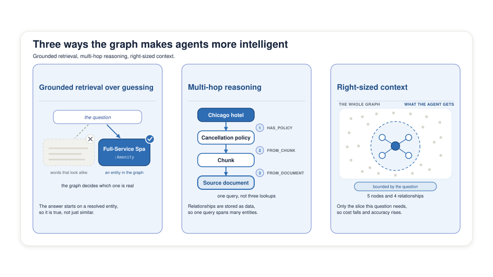
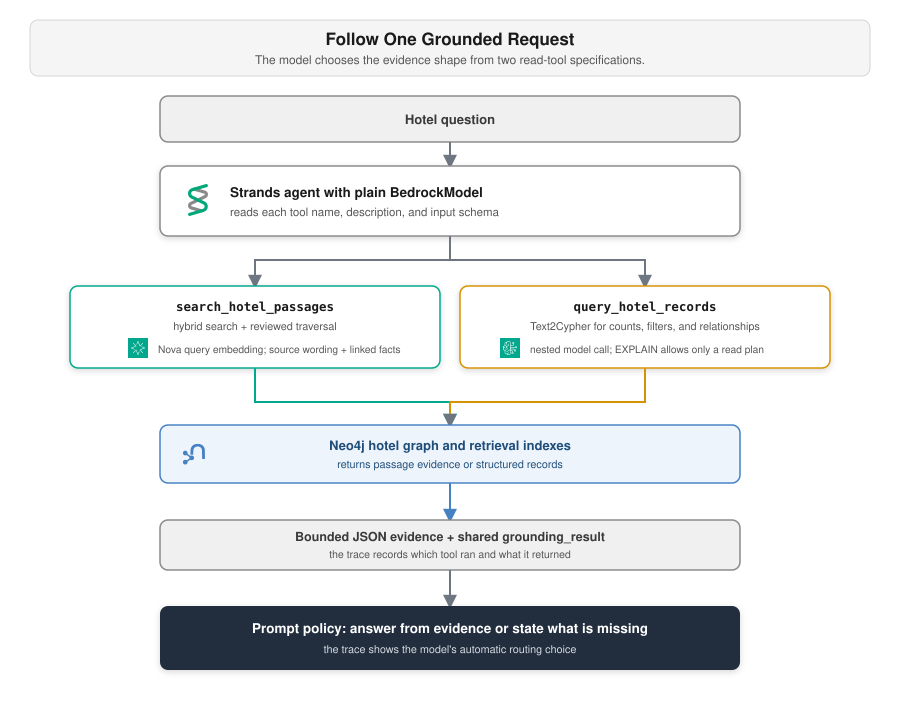

# The Business Case for Grounded Agents

**Lab:** Setup, Neo4j AuraDB Free

A guest asks for a Chicago hotel with a spa and a pool. The model answers with confidence. The graph answers with evidence.

<!--
This deck sets up the whole workshop. The argument runs in a fixed order:
what is at stake, why the model alone fails, why retrieval alone fails, what
a graph adds, third-party evidence, and then the hero question the rest of
the day answers. The deck closes on the demo, the platform roles, the
six-module roadmap, the request flow, and the Aura briefing that starts setup.

Do not explain retrievers here. Deck 4 owns that. This deck only has to make
the room want the graph.
-->

---

## The Enterprise AI Paradox

Modern models already out-reason most people on general knowledge, recall, and synthesis. So why is the booking assistant still wrong?

- **High intelligence** plus **missing operational context** equals confident, useless answers
- The gap is not model capability. It is what the model was never told: how the facts of this business connect

<!--
Open here rather than with the technology. Everyone in the room has watched a
capable model produce a fluent answer about their own business that was simply
untrue. Name that experience, then spend the deck explaining why it happens.

The second bullet is the thesis. Nothing in this workshop makes the model
smarter. Everything in it changes what the model is allowed to see.
-->

---

## The Stakes

A hotel group is putting agents in front of guests. Three failures cost real money, and they are different failures:

- **A wrong answer:** the agent promises a spa the hotel does not have. The chain pays for a refund and absorbs a bad review
- **A wrong action:** the agent holds a room for fifteen guests in a suite that sleeps ten. Someone on the property has to unwind the reservation by hand
- **An unexplainable answer:** nobody can say which document the claim came from

Graph retrieval addresses the first. A controlled write path addresses the second. Graph provenance addresses the third.

<!--
This is where the hotel domain earns its place. The stakes are lower drama
than aviation and higher frequency, which is the honest framing. Every
attendee has a system that answers questions and a system that writes rows,
and most of them have wired an agent to both.

Land the split now, because it is the spine of Module 3. Grounding a read and
constraining a write are two different engineering problems, and most GraphRAG
talks only cover the first.
-->

---

## Why LLMs Alone Fall Short

- **Hallucination:** the model generates the statistically probable answer, not the verified one. It describes an amenity that does not exist as confidently as one that does
- **No access to your data:** the model has never seen this chain's hotels, rates, or policies. Retraining on a newer snapshot of the public web does not change that
- **Relationship blindness:** it cannot connect a policy to the property it governs, or find every hotel that shares one amenity

Plain retrieval narrows the first two gaps. Graph retrieval closes all three, with context that is verified, connected, and focused.

<!--
The closing line is the pivot the next two slides depend on. Say it slowly.

If someone pushes on hallucination as a solved problem, agree partly: plain
retrieval does reduce it. Then make the stronger claim. Graph retrieval does
better on all three gaps. The answer starts on a verified entity, follows
stored relationships, and carries only the facts the question needs. The
third bullet is the one no amount of chunk retrieval fixes.
-->

---

## The Problem Vectors Do Not Solve

Vector search finds text that is **similar**. It cannot **traverse relationships** or **guarantee a condition**.

Three questions this workshop asks of its own hotel documents:

- **"The hotel at postal code 60611"** loses the answer. An embedding of `60611` sits near every other five-digit number, so similarity ranks the right chunk below prose that reads more like the question
- **"Chicago hotels with both a spa and a pool"** returns hotels with one of them. Nothing ties two conditions to the same property
- **"What does this chunk's hotel actually offer"** cannot be answered from the passage. The name, the rating, and the amenity list live in the graph, not in the text

Similar text is not the same as a connected fact.

<!--
These three are not hypotheticals. Module 2 runs all three. The room watches
vector search miss the 60611 chunk before hybrid retrieval finds it, and then
sees the spa-and-pool question answered by reviewed Cypher rather than by
similarity at all.

Postal code 60611 is the demo that changes minds fastest. The fix is a
full-text index, and it lives in the same Neo4j database as the graph. The
exact-term match finds the chunk, and the traversal still attaches the hotel
behind it. Say plainly that an old idea beats the embedding here. That honesty
buys credibility for the spa-and-pool case, where only the graph can tie two
conditions to one hotel.
-->

---

## The Shift to GraphRAG

A knowledge graph stores each hotel as a record and stores the links between records. This amenity belongs to that hotel. That policy governs this room. This fact came from that document.

- **Connected, verifiable facts:** the graph stores facts you can check, not pattern-matched chunks
- **Traversal on top of similarity:** a traversal reaches context that a vector search cannot
- **Traceable:** every answer walks back to the document behind it
- **Fewer tokens:** the graph returns the facts the answer needs, not everything that looked similar
- **Governed retrieval:** the application fixes the traversal, and the model does not choose it

The agent answers from evidence the graph can defend.

<!--
The last bullet is the one that separates this workshop from a generic
GraphRAG talk, and it comes back in deck 5. In most demos the model decides
what to fetch. Here the application decides, once, and the model never gets
that choice.
-->

---

<!--
This is the previous slide as a picture. There is one panel for each word in
the claim: verified, connected, focused.

On the left, the question resolves to a real node, the Full-Service Spa
amenity. It does not resolve to text that only reads like the question.

In the middle, one query walks from the hotel to its cancellation policy, to
the chunk that states it, to the source document. That walk is why every
answer can name its file.

On the right, the agent gets the handful of nodes the question needs. The rest
of the graph stays out of the prompt.

Do not explain the retrievers here. The evidence slide is next.
-->

---

## The Evidence

The UK's National Innovation Centre for Data ran 510 complex questions. Some needed hundreds of steps. Neo4j sponsored the study. NICD ran it.

- **80% more truthful:** 63 against 35 on the study's truthfulness score, which penalizes hallucination
- **Over 2x precision and recall:** precision 0.38 against 0.18, recall 0.35 against 0.15
- **Half the refusals:** vector-only declined 71% of the questions, and GraphRAG declined 35%
- **Fewer tokens per correct answer:** the retriever fetches sections, not whole documents
- **No ontology project:** the graph was built from the titles, sections, and links the documents already carried

GraphRAG answered more than twice as many questions, and it answered them more truthfully.

<small>Source: [Independent study: GraphRAG makes AI agents 80% more truthful](https://neo4j.com/blog/agentic-ai/study-graphrag-ai-agents-80-percent-more-truthful/), Neo4j</small>

<!--
Full NICD report: neo4j.com/whitepapers/nicd-reducing-hallucinations-graphrag/

Two points to land in the room:

The refusal number is the one that changes minds. Vector-only RAG mostly fails
by declining, not by lying, so teams who have only measured hallucination rate
think their system is fine. Ask how useful an assistant is that shrugs at two
out of three real questions.

The last bullet answers the objection that always comes: a graph means a
six-month data modeling project. NICD hand-engineered nothing, and Module 1
does the same thing to the hotel documents with a pinned schema.
-->

---

## The Hero Question

> Which Chicago hotel has both a spa and a swimming pool, what is its cancellation policy, and can I submit a booking request for four guests?

One sentence, three different mechanisms:

- **The spa and the pool:** a Cypher template tests both conditions on the same hotel. Similarity cannot guarantee it
- **The cancellation policy:** hybrid retrieval finds the passage, a graph traversal attaches the hotel and its source document
- **The hold for four guests:** a reservation command validates the guest count, and Neo4j enforces the limit in the write transaction

Add a fourth question, "is a room free tonight," and the graph shows it holds no availability data. The agent declines instead of guessing.

<!--
This question runs through decks 4, 5, 6, and 7 word for word. Do not
paraphrase it later. The repetition is what makes the arc legible.

The fourth line matters as much as the first three. Every attendee has been
asked to build an agent that answers everything, and the useful discipline is
knowing which questions the data cannot support. Module 3 makes the agent
refuse this one on purpose.
-->

---

## Opening Demo

See the finished build answer the hero question live.

Then we look at what each platform brings and the six modules that build it.

<!--
Instructor run instructions:

Run the hero question against the pre-deployed Module 5 AgentCore Runtime
agent, deployed before the event against the instructor's own Aura instance:

"Which Chicago hotel has both a spa and a swimming pool, what is its
cancellation policy, and can I submit a booking request for four guests?"

Show the tool calls, not just the answer, so the room sees the retrieval
happen. Then ask the availability question and let it refuse. The refusal
gets more comment than the answer, every time.

Keep the runtime live all day so attendees can invoke it during breaks. Point
back to this demo from each module: Module 1 builds the graph behind it,
Module 2 chooses its retriever, Module 3 grounds it, Modules 4 and 5 deploy
it, Module 6 gives it memory.
-->

---

## Neo4j and AWS: What Each Platform Brings

| Component | Role in this workshop |
|---|---|
| **Neo4j Aura** | Stores connected hotel facts, source text, indexes, business rules, reservation requests, and memory |
| **Amazon Bedrock** | Provides Claude for extraction and reasoning, Amazon Nova for retrieval embeddings, Titan Text Embeddings V2 for memory |
| **Strands Agents** | Gives the model its tools and runs the agent loop |
| **AgentCore** | Exposes remote tools through Gateway and runs the deployed agent on Runtime |

The graph holds more than the retrieval corpus. Business rules and reservation requests live there too, and that is what makes the write path in Module 3 enforceable.

<!--
Give the two platforms parallel treatment. Neo4j holds connected facts and
rules. Bedrock provides reasoning and embeddings. Each platform owns a clear
part of the request path.

The closing line is the one that is worth slowing down for. Most agents keep
their business rules in a system prompt, where the rule and the reasoning share
one surface and the model can talk itself past either. Here a rule is data in
the same database as the booking, so Module 3 can check it inside the
transaction that writes.

The two agent layers arrive as the day goes on. The graph and the models are in
every module.
-->

---

## What You Will Build

Six modules, six verbs:

1. **Build** a knowledge graph from hotel documents into your own Aura instance
2. **Compare** eight retrieval patterns and identify complementary question shapes
3. **Ground** an agent in two bounded read tools, and keep its write path separate
4. **Publish** the retrieval tools through AgentCore Gateway, on the Model Context Protocol
5. **Deploy** the whole agent to AgentCore Runtime as a container
6. **Remember** guest preferences in the same graph, with provenance

Modules 3, 4, and 5 reuse the same boundaries while packaging their tools differently.

<!--
This deck's thesis, restated: the model does not get smarter across these six
steps. What changes is what it can see and what it is allowed to do.

Say the grouping out loud, because it saves questions later. Modules 1 and 2
are where the day's understanding gets built. Modules 3, 4, and 5 are the same
design deployed three ways, so nobody should spend Module 5 wondering why the
Gateway disappeared. If you fall behind, 4 and 5 are the ones to demonstrate
rather than have everyone run.
-->

---

<!--
Walk this end to end, once, slowly. It is the only time today the whole path
is on one slide.

A question arrives at the Strands agent running a model on Bedrock. The model
reads two tool specifications. It can choose passage search, which uses Nova,
the vector and full-text indexes, and a reviewed traversal, or a structured
record query, which adds a model call to generate Cypher and an `EXPLAIN`
read-plan check. Bounded evidence and a shared verdict come back to the model.

The reservation write is not on this path at all. It runs beside the agent.
Application code and Neo4j own it, and deck 5 shows how.

The packaging changes across later modules. Module 3's key lesson is the
model-driven choice between two local read tools.

The next slide is the Aura briefing. Setup starts there.
-->

---

## Neo4j Aura: Where Your Graph Runs

Neo4j as a managed service, with no server for you to run.

- **AuraDB Free:** The tier takes no card, runs no cluster you manage, and gives one database per instance
- **Your own instance:** You create it, and it is not shared with anyone else in the room
- **Restore from a dump file:** The workshop graph loads through the console's Restore tab
- **Query and Explore:** Query runs Cypher and shows results as a table or as a rendered graph. Explore lets you click through the graph without writing Cypher
- **Idle pause:** A Free instance pauses after three idle days. A paused instance refuses connections, which reads exactly like a wrong URI

Setup starts now. Create your AuraDB Free instance and restore the workshop graph. The Setup page has the steps.

<!--
This slide is the setup briefing. Setup starts when it ends.

A shared database hides individual mistakes until the last module. A personal
one surfaces them immediately.

Two steps need the room's full attention, so stop talking while people do
them. Aura shows the generated password once, so everyone downloads the
credentials file. The instance has to report RUNNING before the restore
starts, because a restore into an instance that is still provisioning fails.

Tell the room to open Query once the restore finishes, run the hero-hotel
check, and look at the rendered graph. Seeing their own restored data as a
picture does more for intuition than any slide here.

The pause limit is the single most common support question. Say it now, and
say it again to anyone who comes back from a long break with a connection
error.

Keep these for questions. Every connection uses `neo4j+s://`, which is
encrypted. The Free tier holds 200,000 nodes and 400,000 relationships, and
the workshop graph sits far under both. Aura Professional adds sizing,
snapshots on demand, and cloud region choice, and none of the day depends on
any of it.

Present the knowledge graph deck while the instances provision and the restore
runs. The room fills in `CONFIG.txt` and runs the environment check after that
deck.
-->
