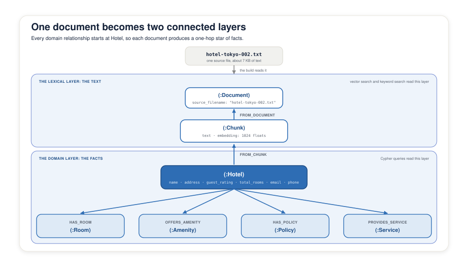

<style>
section {
  --marp-auto-scaling-code: false;
}

li {
  opacity: 1 !important;
  animation: none !important;
  visibility: visible !important;
}

/* Disable all fragment animations */
.marp-fragment {
  opacity: 1 !important;
  visibility: visible !important;
}

ul > li,
ol > li {
  opacity: 1 !important;
}
</style>

# From Documents to a Knowledge Graph

**Lab:** Module 1, Notebook 1.1
`1.1_build_graph.ipynb`

Hotel FAQ documents become a graph you can query

<!--
The hinge of this deck is the "Schema Drift, and What It Costs" slide.
Everything before it shows
the graph the build has to produce, and everything after it is the machinery
for taking the modeling decisions away from the model.

Do not turn this into a SimpleKGPipeline API tour. The room does not need the
argument list; they need to understand why the schema is pinned and why
amenities are parsed rather than extracted.
-->

---

## The Two-Layer Graph

Every document produces structure in two layers:

- **Lexical layer:** `Document` holds the source file. `Chunk` holds the text and its embedding
- **Domain layer:** `Hotel` holds the facts, with typed edges to `Room`, `Amenity`, `Policy`, and `Service`
- **The bridge:** `FROM_CHUNK` ties each extracted entity to the chunk it came from. `FROM_DOCUMENT` ties that chunk to its file

Search enters through the lexical layer. Answers come from the domain layer.

<!--
Say the last line twice. It is the reason the schema has two halves and it is
the thing Module 2 depends on completely.

The bridge run backward is provenance. Given a hotel fact, one hop gets you the
chunk, two hops get you the filename. Module 3's grounded answers print that
filename, and this edge is why they can.
-->

---



<!--
One file, two layers, one edge between them.

Trace the write direction now, left to right: the file becomes a Document, the
Document holds a Chunk, the Chunk text goes to Claude, and Claude's output
becomes the Hotel and everything hanging off it.

Then trace it backward, which is the direction Module 2 reads it. This same
picture appears in deck 4 with a retrieval path drawn over it.
-->

---

<style scoped>
/* Four rows of two-column prose. */
section { font-size: 25px; }
</style>

## Schema Drift, and What It Costs

Real labels from schema-free extraction runs over this corpus:

| Drift | Labels the model chose | Why a query breaks |
|---|---|---|
| Property promoted to a node | `Address`, `Fee`, `Location` | The address is on the hotel in one document and one hop away in the next |
| Type split from instance | `RoomType`, `BedConfiguration` | A room's own properties become separate nodes to join through |
| Two names for one thing | `ContactMethod`, `ContactInfo` | Both are reasonable, and the query has to know which one this document used |
| Geography expanded | `City`, `Country` | The city is text inside an address in most documents and a node in a few |

Each graph describes its own document correctly. No Cypher query works across all of them.

<!--
This is the deck's hinge. Land the last line hard.

Nothing here is a hallucination. Every one of these labels is accurate about
the document it came from. The failure is that the corpus ends up with four
different shapes for the same fact, and a corpus-wide query needs one shape.

The Module 1 notebook has an optional cell that runs schema-free extraction
against an isolated source identity and prints the labels it created, then
cleans up after itself. Run it live if you have the room's attention. Seeing
their own drift beats reading this table.
-->

---

## Pinning the Extraction Schema

The fix is a schema the pipeline enforces, not a longer prompt:

```python
(:Hotel)-[:HAS_ROOM]->(:Room)
(:Hotel)-[:HAS_POLICY]->(:Policy)
(:Hotel)-[:PROVIDES_SERVICE]->(:Service)
```

- **`node_types`, `relationship_types`, `patterns`** go to `SimpleKGPipeline` as its `schema` argument
- **Schema-driven pruning** drops anything outside the vocabulary before the graph write
- **Property descriptions steer values:** `guest_rating` becomes the float `4.6`, not the string `4.6/5.0`

The model still reads the prose. It no longer chooses the vocabulary.

<!--
Draw the line between prompting and enforcement. Asking the model nicely to use
these labels gets you most of the way and fails on the document that does not
fit. Pruning at the write boundary means an off-schema label cannot reach the
database at all.

The guest_rating detail looks small and is not. Module 2 averages that field.
A column of strings that mostly look like numbers is the kind of defect that
surfaces three modules later.
-->

---

## Not Everything Should Be Extracted

Amenities come from a deterministic parser, not from Claude:

1. Every document has a `## Hotel Amenities` bullet list
2. The parser reads the bullets under that heading and stops at the next heading
3. The trimmed bullet text becomes `Amenity.name`
4. Neo4j merges that exact name into one shared node

"Pool facilities are not available at this property" creates no Pool relationship.

<!--
The model is good at prose and the parser is exact at lists. Use each for what
it is good at.

The negated sentence is the example that convinces people. An extractor reading
that line sees a hotel and a pool near each other and has to reason about the
negation. The parser never reads the sentence, because it is not in the
amenities list.

The exact-name merge is what makes Amenity a shared node across the corpus. If
one document said "Swimming Pool" and another said "Pool", the shared-amenity
traversal would silently return half the hotels.
-->

---

<style scoped>
/* Six rows of stage descriptions. */
section { font-size: 25px; }
</style>

## The Pipeline, Six Stages

| Stage | What happens |
|---|---|
| **Split** | `FixedSizeSplitter` cuts the document into slices |
| **Embed** | Amazon Nova turns each slice into a 1024-dimension vector on the `Chunk` |
| **Extract** | Claude returns JSON of nodes and relationships, restricted to the schema |
| **Resolve** | Global name-based resolution stays **off** |
| **Write** | `Document`, `Chunk`, and entity nodes are created and connected |
| **Amenities** | The parser merges shared `Amenity` nodes by exact name |

`SimpleKGPipeline` runs the first five. The amenity parser runs the last.

<!--
Resolve is the row to explain. Global name-based entity resolution would merge
two hotels that share a name in different cities, and this corpus has exactly
that pattern. Leaving it off keeps them distinct.

Extraction is also where the token limit matters. A complete hotel can produce more
JSON than the Bedrock client's 4096-token default, and truncation cuts a JSON
object in half rather than failing cleanly. The build raises the extraction
limit and retries once.
-->

---

## Chunking Here, and Why

One chunk per document, and zero overlap.

- **The largest document is 7,442 bytes**, well under the splitter's 12,000-character limit
- **The hotel's name, rooms, policies, and services stay in one chunk**, so extraction sees them together
- **Overlap is zero** because there is no second chunk to overlap with

The same embedder writes the document vectors and the query vectors.

<!--
This is a property of this corpus, not general advice. Deck 4 covers chunking
as a real trade-off. Here the documents are small enough that the trade-off
does not arise, and saying so honestly is better than pretending a decision
was made.

The last line matters more than it looks. Document and query embeddings have to
come from the same model, at the same dimension, for the same purpose, or
cosine similarity compares vectors from two different spaces and returns
plausible garbage while reporting success.
-->

---

## Indexes That Power Search

| Index | Reads | Finds |
|---|---|---|
| `hotel_chunk_embeddings` | `Chunk.embedding`, cosine over 1024 dims | Text that means the same thing in different words |
| `hotel_chunk_fulltext` | `Chunk.text` | Exact strings, such as a postal code or a hotel name |

Plus one uniqueness constraint: `Amenity.name`.

<!--
The dump ships without either index on purpose. Creating them is this module's
other job, and every retriever in Module 2 depends on both.

Preview the reason there are two rather than one: an embedding of 60611
resembles every other five-digit number, so vector search ranks the right chunk
too low. Full-text matches the literal token. Deck 4 runs that failure live.

Do not explain hybrid search here. Deck 4 owns it.
-->
