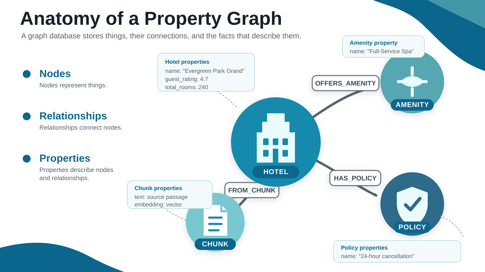
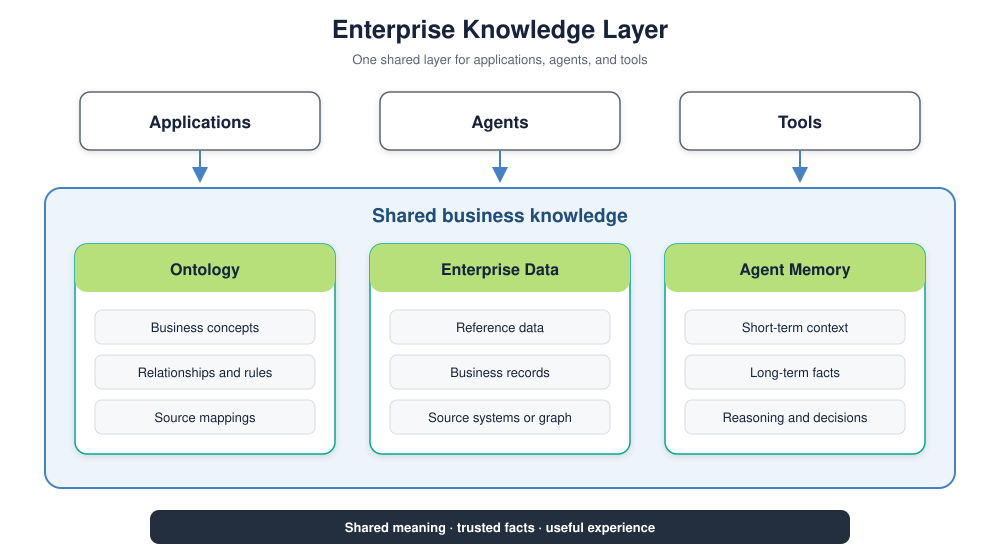

<style>
section {
  --marp-auto-scaling-code: false;
}

li {
  opacity: 1 !important;
  animation: none !important;
  visibility: visible !important;
}

/* Disable all fragment animations */
.marp-fragment {
  opacity: 1 !important;
  visibility: visible !important;
}

ul > li,
ol > li {
  opacity: 1 !important;
}
</style>

# Knowledge Graph Foundations

**Lab:** Setup, Notebook 1.0
`1.0_verify_environment.ipynb`

What a property graph is, and how the hotel graph is modeled

<!--
The room starts this deck while their Aura instances provision and the restore
runs. Pause when someone needs help with a setup step.

Open with the question deck 1 named, the one no single passage of text
answers. The answer lives in the connections between facts, and this deck is
what those connections actually are.

The deck runs from nodes and relationships to Cypher, and then to the hotel
schema the room is restoring. Attendees who already know graphs can relax
through the first half.

Do not explain retrieval here. Deck 4 owns vectors, hybrid search, and
retrievers. This deck only has to make the graph feel like a normal database.
-->

---

## What Is a Graph Database

Three structures, and that is the whole model:

- **Node:** A node is a thing, such as a hotel, a room, an amenity, a document, or a text chunk
- **Relationship:** A relationship is a named, directed connection between two nodes
- **Property:** A property is a named value stored on a node or on a relationship

The relationship is stored, not computed. Following one is a pointer hop, not a join.

<!--
The last line is the one that matters to anyone who has tuned a relational
database. In a relational store the connection between two rows is derived at
query time by matching values. In a property graph it is written down once and
traversed directly, so the cost of a hop does not grow with the size of the
table on the other side.

That single property is why the multi-hop questions later in the day are cheap
here and expensive in SQL.
-->

---



<!--
Use the diagram as a visual pause after the definition. Start with the four
circles. Each circle is a node that represents one thing. Then follow the
named arrows from the Hotel node. Those stored relationships make the graph
read like the business domain.

Finish with the property callouts. The values stay with the nodes they
describe, while FROM_CHUNK keeps the Hotel connected to its source text.
-->

---

## Graph Notation

Cypher is Neo4j's query language. A pattern is written the way it is drawn:

```cypher
(:Hotel {name: "AnyCompany Cairo Nile View"})
    -[:OFFERS_AMENITY]->
(:Amenity {name: "Full-Service Spa"})
```

- **Parentheses** describe nodes
- **`:Hotel`** is a label, the node's type
- **Square brackets** describe relationships
- **The arrow** carries direction
- **Braces** hold properties

<!--
Read the pattern out loud as an English sentence: this hotel offers this
amenity. Cypher's whole design bet is that a query should look like the shape
it is looking for.

Point out that direction is stored but rarely required at query time. You can
match the pattern in either direction, and Module 2's retrieval queries do.
-->

---

## From Graph Database to Knowledge Graph

A graph database stores nodes and relationships. A knowledge graph uses a shared schema that defines what they mean.

- **Node labels:** The schema defines `Hotel`, `Room`, `Amenity`, `Policy`, and `Service`
- **Relationship types:** The schema defines names such as `OFFERS_AMENITY`, `HAS_POLICY`, and `FROM_CHUNK`
- **Business meaning:** The labels and relationships use terms that a domain expert understands
- **Provenance:** every extracted fact keeps a link back to the text it came from

The schema is the shared model. Module 1 pins it so extraction uses the same labels and relationships every time.

<!--
This workshop uses a schema. The schema is a Python dictionary of five node
types, their properties, and their relationships. A formal ontology would add
more semantic rules and inference. This workshop uses a small schema.

Provenance links each fact to its source text. Module 3 returns the source
filename with the answer.
-->

---



<!--
The Enterprise Knowledge Layer gives applications, agents, and tools one shared
source. The ontology defines meaning. Enterprise data supplies current facts.
Agent memory carries useful experience into the next request.

The full overview comes from Jesús Barrasa's article, The knowledge layer for
enterprise AI. The Graph Intelligence Platform page links to the article.
-->

---

<style scoped>
/* Six comparison rows plus one takeaway. */
section { font-size: 22px; }
table { font-size: 18px; width: 100%; }
th, td { padding: 9px 12px; }
</style>

## Same Hotel Business, Two Question Shapes

| Question | Best fit | Why |
|---|---|---|
| What is the average nightly rate next month? | Relational database, SQL aggregation | Group and average many rate rows |
| Which rooms are available for four guests tonight? | Relational database, SQL filter | Check dates, inventory, and room capacity |
| How many reservation requests were accepted this week? | Relational database, SQL aggregation | Count time-stamped transaction rows |
| Which Chicago hotel has both a spa and a pool? | Neo4j, Cypher pattern | Both amenities must connect to the same hotel |
| What cancellation policy applies to that hotel? | Neo4j, Cypher traversal | Follow the hotel to its policy |
| Which source document supports the answer? | Neo4j, GraphRAG | Follow the hotel to its chunk and document |

**Together:** SQL answers availability and transaction questions. Neo4j answers how hotel facts connect and where they came from.

<!--
The split follows the shape of the question. SQL works well when the answer
comes from filtering or aggregating rows. Neo4j works well when the answer
depends on a connected pattern, a path, or provenance.

The availability row is deliberate. This workshop's graph does not store room
inventory. The correct system for that question is the reservation system
that owns the current inventory rows.
-->

---

<style scoped>
/* Two code blocks plus framing prose. */
section { font-size: 24px; }
</style>

## Graphs and Relational Databases: The Hard Question

"Which Chicago hotels have both a spa and a pool, and what is their cancellation policy?"

```sql
SELECT h.name
FROM hotel h
JOIN hotel_amenity ha1 ON ha1.hotel_id = h.id
JOIN amenity a1 ON a1.id = ha1.amenity_id AND a1.name = 'Full-Service Spa'
JOIN hotel_amenity ha2 ON ha2.hotel_id = h.id
JOIN amenity a2 ON a2.id = ha2.amenity_id AND a2.name = 'Outdoor Swimming Pool'
WHERE h.address LIKE '%Chicago%';
```

Correct, and it still does not have the cancellation policy. That needs two more joins.

<!--
Walk the joins. Two amenities means the amenity tables appear twice, aliased,
and every additional condition adds another pair. The query grows by the
condition, not by the answer.

Then point at the shape of the growth. Adding the policy adds a hotel_policy
table and a policy table, so the query is eight joins for a question a guest
would ask in one breath. Nothing here is beyond SQL. The cost is that the
query text grows with the number of conditions rather than with the answer.
-->

---

## The Same Question in Cypher

```cypher
CYPHER 25
MATCH (h:Hotel)-[:OFFERS_AMENITY]->(:Amenity {name: "Full-Service Spa"})
MATCH (h)-[:OFFERS_AMENITY]->(:Amenity {name: "Outdoor Swimming Pool"})
WHERE h.address CONTAINS "Chicago"
OPTIONAL MATCH (h)-[:HAS_POLICY]->(p:Policy)
RETURN h.name AS hotel, collect(p.name) AS policies
```

Each condition is one more line, not one more pair of joins.

The question SQL cannot reach is the next one. "Which other hotels offer this amenity" is one hop from a node you already hold.

<!--
Cypher glossary, for the room that has not seen it:

MATCH selects a pattern. Two MATCH clauses sharing the variable h mean both
patterns must hold for the same hotel, which is how the AND is guaranteed.

OPTIONAL MATCH keeps the hotel in the result even when the pattern does not
match, the way a LEFT JOIN does. Module 2's retrieval queries use it
everywhere, because a missing policy should not delete a hotel from the
results.

collect aggregates matched rows into a list, so one row comes back per hotel
rather than one per policy.

WHERE filters. RETURN names the fields the application receives.

CYPHER 25 pins the language version, so the query means the same thing on any
server the workshop runs against. Every Cypher query in the workshop carries it.

That is enough Cypher to read every query in this deck. Modules 2 and 6 add
CALL and WITH, and each one is introduced where it is first used. MERGE comes
up two slides on, where it creates the shared amenity node.
-->

---

<style scoped>
/* Seven rows with examples plus three closing paragraphs. */
section { font-size: 20px; }
</style>

## The Hotel Knowledge Graph

| Label | Represents | Key properties |
|---|---|---|
| `Hotel` | One hotel in the chain | `name`, `address`, `guest_rating` |
| `Room` | A bookable room type | `type`, `max_occupancy`, `min_rate`, `max_rate` |
| `Amenity` | A facility, unique across the graph | `name` |
| `Policy` | A rule that governs a stay | `name`, `description` |
| `Service` | Something the hotel provides, free or paid | `name`, `cost`, `hours` |
| `Document` | One source FAQ file | `source_filename` |
| `Chunk` | A searchable passage of that file | `text`, `embedding` |

`Document` and `Chunk` are the lexical layer. Everything else is the domain layer.

Hundreds of properties worldwide. These eight carry the workshop: Cairo, Chicago, Paris, Tokyo, Sydney, Rio de Janeiro, Cape Town, Prague.

You restore this from a prebuilt dump, and the dump deliberately ships with no vector index, no full-text index, and five hotels missing. Module 1 is where all three arrive.

<!--
The two-layer split is the single most important structural idea in the
workshop's schema, and Module 1's deck takes it apart in detail. Name it here
and move on.

The last line is the setup for Module 1. Participants often assume a prebuilt
graph means there is nothing to build. There is: the two indexes that every
later retrieval depends on, and five held-out documents to extract.

Cairo is deliberately not one of the five. Module 2's comparison has to work
identically for everyone, so it cannot depend on a participant's own extraction
run. The hero hotel, AnyCompany Cairo Nile View, also appears in the
environment check, in Module 3's grounded answer, and in the Module 5 smoke
tests. If someone sees it three times and asks, that is why.

Amenity being unique across the graph is the second thing to flag. Two hotels
with a spa point at the same Amenity node, so "which other hotels have this"
is one hop from a node you already have. The next slide shows that shared node.
-->

---

<style scoped>
/* One graph pattern plus four modeling points. */
section { font-size: 25px; }
</style>

## Shared Amenity Nodes Connect Hotels

`Full-Service Spa` is one shared `Amenity` node. Every hotel that offers it connects through `OFFERS_AMENITY`.

```cypher
CYPHER 25
MATCH (a:Amenity {name: "Full-Service Spa"})
      <-[:OFFERS_AMENITY]-(h:Hotel)
RETURN a.name, collect(h.name) AS hotels
```

- **One shared entity:** `MERGE` creates one node for the normalized amenity name
- **Two-way traversal:** start at a hotel to list amenities, or start at an amenity to find hotels
- **Connected context:** continue from each hotel to rooms, policies, services, chunks, and documents
- **Composable paths:** Module 2 starts from a search match and walks outward through these relationships

The graph stores the amenity once and makes every connected path available for traversal.

<!--
- Read the pattern from right to left. Each Hotel points to the same Amenity.
- Module 1 normalizes amenity names before writing them.
- MERGE uses the normalized name to create one shared node.
- A traversal can start at the Hotel or the Amenity.
- From the matched Hotel, the query can continue to policies, rooms, services,
  chunks, and source documents.
- Module 2 uses this outward traversal to assemble connected context.
-->

---

<style scoped>
/* Five module bullets, a closing line, and the setup prerequisites. */
section { font-size: 25px; }
</style>

## Where the Graph Goes Next

The graph you are restoring is the one every module reads:

- **Module 1** adds two indexes and five more hotels to it
- **Module 2** retrieves from it eight different ways
- **Module 3** grounds an agent in it, and writes a reservation into it
- **Module 6** writes guest preference memory into the same graph
- **Modules 4 and 5** change where the code runs, and not the graph

One database carries all six modules. You never create a second one.

To finish setup you need your restored Aura instance, an AWS account with Bedrock access in **us-east-1**, a filled-in `CONFIG.txt`, and a passing environment check. Setup has the steps.

<!--
This is the forward pointer. It also answers the question people are holding:
whether they are about to accumulate a pile of infrastructure. They are not.
One Aura instance and one AWS account carry the entire day.

Do not read the setup line out. It is on the screen so people know what is
coming, and the setup pages have the actual steps.

The environment check runs before Module 1. On Vocareum it is the
`1.0_verify_environment.ipynb` notebook. On an own-account setup it is
`environment/verify.py`, which runs from a terminal. Both check the installed
packages, the AWS credentials, the hero hotel in the graph, and each of the
three Bedrock models. Tell the room to read the first failure rather than the
last.

Go back to Setup and finish it. Every path ends in the same place: four Neo4j
settings in CONFIG.txt, AWS credentials in us-east-1, and a passing
environment check.
-->
