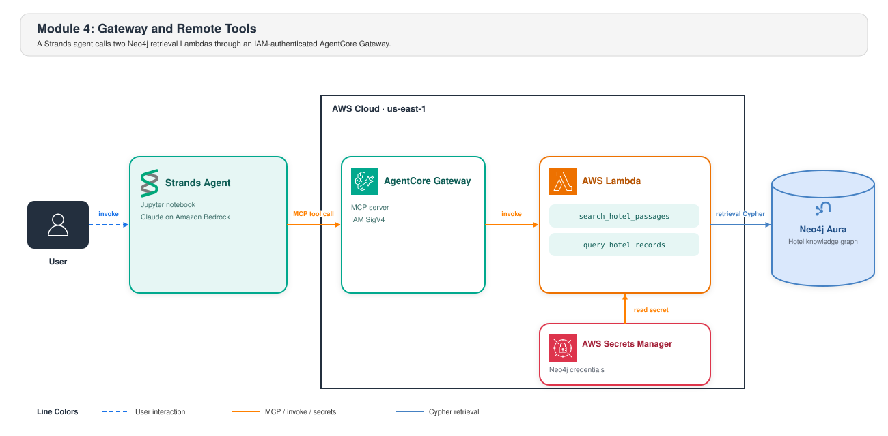

<style>
section {
  --marp-auto-scaling-code: false;
}

li {
  opacity: 1 !important;
  animation: none !important;
  visibility: visible !important;
}

/* Disable all fragment animations */
.marp-fragment {
  opacity: 1 !important;
  visibility: visible !important;
}

ul > li,
ol > li {
  opacity: 1 !important;
}
</style>

# Hotel Search Tools Behind AgentCore Gateway

**Lab:** Module 4, Notebook 4.1
`4.1_agentcore_gateway.ipynb`

Module 4 moves the agent's two hotel search tools from the notebook to AWS Lambda. AgentCore Gateway makes those tools available to the agent.

These slides follow the notebook. They cover what moves, the Lambda tools, the Gateway, how the agent calls the tools through MCP, and how each request is secured.

<!--
Module 4 moves the two read tools out of the notebook. Each tool runs in a
Lambda function behind AgentCore Gateway. The local Strands agent discovers
and calls those tools through MCP.

Module 5 is a separate deployment pattern. It packages the agent and its tools
in an AgentCore Runtime container. That agent connects to Neo4j directly. It
uses its packaged tools instead of the Module 4 Gateway path.

The retrieval logic stays the same. Its deployment location and IAM boundary
change.
-->

---

<style scoped>
/* Five rows of two-column prose. */
section { font-size: 24px; }
</style>

## What Moves and What Does Not

| Aspect | Module 3, local `@tool` | Module 4, Gateway tool |
|---|---|---|
| Where the code runs | The notebook process | An AWS Lambda function |
| How the model learns the tool | `@tool` exposes a generated tool specification | The Gateway lists each tool and its schema |
| Who holds the Neo4j credential | The notebook process | The Lambda, from Secrets Manager |
| Who checks the caller | Nobody. The caller is the process | IAM checks the SigV4 signature |
| What the agent passes to Strands | Two local tools | The same two tools, listed by the Gateway |

The agent stays local. The tools go remote.

<!--
Name the three problems with the notebook process without dwelling: the
credential is in the process, nothing checks who is calling, and the only way
to share the tool is to share the notebook.

Row four is the one that matters. In Module 3 there is no caller to check,
because the caller and the tool are the same process. The moment the tool moves
out, "who is allowed to call this" becomes a real question, and IAM answers it.

Row five is the transport change. Module 3 passes two decorated Python tools.
Module 4 passes the same two tools after the Gateway lists them. A later slide
shows that line of code.
-->

---

## The Two Tools Move to Lambda

Module 3 defined `search_hotel_passages` and `query_hotel_records` as local tools. Module 4 deploys each one as its own Lambda function.

- **Handler:** Each handler checks the one `query` input, calls the same retrieval code as Module 3, and returns the same grounding response
- **Credential:** Each Lambda reads the Neo4j connection from Secrets Manager at cold start
- **Package:** Each zip holds the `workshop` package and the Neo4j driver libraries
- **Check:** The notebook invokes both functions directly. It asks about a hotel that exists and one that does not, and it confirms that a generated write is rejected

The retrieval code does not change. The reservation command does not move. Both Lambda tools only read.

<!--
Deck 5 introduced these two tools on "Two Read Tools, One Boundary." Do not
explain them again. This slide only covers how each one becomes a Lambda
function.

The bullets follow Steps 2 through 5 of the notebook. Step 2 prints the two
handlers. Step 3 stores the Neo4j connection in Secrets Manager. Step 4 builds
one zip per tool and deploys it. Step 5 invokes both functions directly.

Both handlers call the same implementations in hybrid_retrieval.py. Module 4
keeps the same model-visible tool names that Module 3 used.

Step 5 asks about a hotel that exists and a hotel that does not. A broken
retrieval path and a genuine miss both return an empty result, so the notebook
runs both checks. Step 5 also runs a stub model that always generates a write.
The EXPLAIN guard must reject that write before execution.

One trap worth naming: packaging errors appear at invocation and not at
deployment. create_function accepts any zip, and a missing dependency shows up
the first time the function runs.

The last line is deliberate and worth saying out loud. Moving the tools did
not change the rule that the model does not write.
-->

---

## Two Ways Module 4 Connects to Neo4j

AWS connects to Neo4j in several ways. Module 4 uses the two that serve live requests.

- **Neo4j driver in each Lambda:** The driver lets the Lambda run Cypher directly. The connection comes from Secrets Manager
- **MCP for the agent:** MCP lets the agent call the Lambda tools through a standard interface. AgentCore Gateway provides that interface

The driver connects the Lambda to Neo4j. MCP connects the agent to the Lambda.

<small>Source: [Neo4j MCP](https://neo4j.com/developer/genai-ecosystem/model-context-protocol-mcp/)</small>

<!--
The Lambdas are built. This slide covers how each one reaches Neo4j and how the
agent will reach the Lambdas.

Each Lambda holds a Neo4j driver. The driver is the same one the rest of the
workshop uses. Modules 1 through 3 connect with it, and so do Modules 5 and 6.

The agent still needs a way to reach the Lambdas. That is MCP, and AgentCore
Gateway provides the MCP endpoint. The next slide covers the Gateway.

AWS has three other connection patterns. The Spark Connector on Amazon EMR, the
AWS Glue Connector, and the Kafka Connector on Amazon MSK move data in bulk.
Module 4 does not use them. Mention them only if someone asks.
-->

---

## AgentCore Gateway

The two Lambda functions need an endpoint the agent can call. AgentCore Gateway provides one managed MCP endpoint in front of both.

- **Gateway:** the MCP server. It owns the URL, the protocol, and the authorizer
- **Target:** one registered backend. It names a Lambda and the tool schema to advertise for it

```python
gateway = control_client.create_gateway(
    name=GATEWAY_NAME, roleArn=gateway_role_arn,
    protocolType="MCP", authorizerType="AWS_IAM",
)
```

Adding a tool means registering another target. The agent, the client, and the URL do not change.

<!--
Two settings define what this is. protocolType="MCP" makes the endpoint an MCP
server. authorizerType="AWS_IAM" selects SigV4, so callers present AWS
identities and there is no API key to distribute or rotate.

One operational note that costs people time: wait for status. Targets can only
be added once the Gateway leaves CREATING, and a session opened before every
target reports READY lists an incomplete tool set rather than failing. The
notebook polls for both.

Also flag the name prefix. The Gateway advertises each tool under a longer
name. Use `gateway_base_name` to split the Gateway name and compare the base
name. Do not use a suffix match because it can select the wrong tool.
-->

---

## Model Context Protocol

The tools now run in Lambda behind the Gateway. The agent needs a standard way
to find and call them.

**MCP:** A standard that lets an agent discover a tool's name, inputs, and
result format at runtime.

- **`tools/list`:** the client asks what exists. Each tool comes back as a name, a description, and a JSON Schema for its input
- **`tools/call`:** the client sends a tool name and arguments. The server runs it and returns the result

Strands calls these as `list_tools_sync()` and `call_tool_sync()`. The Gateway answers them.

An MCP tool is three things: a name, an input schema, and something callable.

<!--
The last line is the one that makes MCP feel small rather than mysterious. A
local Python function decorated with @tool is exactly those same three things.
That is why the agent code at the end of this module looks almost identical to
Module 3's.

Do not detour into the rest of the MCP specification. Two operations is all
this workshop uses.
-->

---

## The Tool Schema Is the Contract

`tools/list` returns the schema registered with each target. The schema is committed to the repository, so every run advertises the same contract.

- **The description is model input.** It replaces Module 3's docstring. The model reads it to choose between the two tools
- **What to write:** State what the tool is for, what question shape it suits, and what it will not do
- **The Gateway reads a subset of JSON Schema.** It keeps `type`, `description`, and `items` on each property
- **The Gateway ignores the stricter keys.** It drops `minLength`, `format`, and `additionalProperties`

Validate in the handler. The Gateway drops the constraint, so nothing else enforces it.

<!--
The subset behavior is the practical trap. The committed schema keeps the
stricter keys because the local tools validate against them, and the notebook
projects the schema down to the keys the Gateway actually reads. If you assume
minLength is enforced, an empty query string reaches your handler.

One more cap worth knowing: a target description is limited to 200 characters.
The notebook gives the target the opening sentence and gives the tool the full
text, so the cap trims the operator-facing label rather than the text the model
reads.
-->

---

## The Same Agent Loop, Remote Tools

```python
agent = Agent(tools=gateway_mcp.list_tools_sync(), ...)
```

`gateway_mcp` is the signed MCP client for the Gateway. The identity slide shows how it is built.

Strands receives local tool specifications in Module 3 and MCP tool specifications here.

> Which Chicago hotel has both a spa and a swimming pool, what is its cancellation policy, and can I submit a booking request for four guests?

Same question and model-driven routing. The selected tools now run in Lambda.

<!--
This is the payoff, and it is deliberately anticlimactic. Everything hard in
this module was deployment and identity. The Strands loop stays the same while
the tool provider changes.

That is the point of a protocol. The agent does not know or care that its tool
is now a Lambda behind a signed HTTPS endpoint.

Run the hero question here if you are demonstrating live. The model picks a
remote tool, answers from the returned context, and records the tool it chose
in the trace, which is the thing worth showing.
-->

---



<!--
This diagram puts every piece from the earlier slides in one picture. Follow
one request across it.

The agent runs in the notebook and calls Claude on Bedrock. Its MCP tool call
crosses into AWS and reaches the Gateway, which checks the SigV4 signature. The
Gateway invokes the Lambda backing that tool. The Lambda read its Neo4j
credential from Secrets Manager at cold start. It sends EXPLAIN-checked Cypher
to Aura.

Note where Aura sits: outside the AWS Cloud boundary, because it is a
separately managed database.

The next two slides cover security for this flow. The first follows the
signature across these hops. The second covers the Aura boundary.

Arrow colors: dashed blue is the user talking to the agent, orange is the MCP
call plus the Lambda invocation plus the secret read, solid blue is the
retrieval Cypher.
-->

---

<style scoped>
/* A code block, four bullets, and a closing line overflow at the theme's 29px. */
section { font-size: 24px; }
</style>

## Identity, SigV4 All the Way Down

```python
from mcp_proxy_for_aws.client import aws_iam_streamablehttp_client

gateway_mcp = MCPClient(lambda: aws_iam_streamablehttp_client(
    endpoint=GATEWAY_URL,
    aws_region=REGION,
    aws_service="bedrock-agentcore",
))
```

- **`mcp-proxy-for-aws`** sends an MCP request as a signed HTTPS request
- **The caller** proves its identity to the Gateway with SigV4
- **`workshop-hotel-gateway-role`** lets the Gateway invoke functions named `hotel-booking-*`
- **`workshop-hotel-lambda-role`** lets the Lambda read one secret and invoke the embedding model and the chat model

AWS IAM controls access to Gateway, Lambda, and Secrets Manager. The Neo4j
credential controls database access.

<!--
Walk the chain as three hops with three different identities. The caller never
holds the Neo4j credential, and that is a property of the role split rather
than of anyone being careful.

The client signs each request with the AWS credentials the notebook is
already using. The Gateway sees that identity and IAM permissions apply to it.

One operational note: IAM is eventually consistent, so a freshly created role
can be rejected for a few seconds after it exists. The notebook retries that
specific failure rather than stopping.
-->

---

## Neo4j Sits Outside the AWS Boundary

Aura is a separately managed database. The trust boundary does not stop at the VPC edge.

- **IAM controls** who invokes the Gateway and who invokes the Lambda
- **The Lambda role controls** which identity can read the Neo4j credential from Secrets Manager
- **Neo4j controls** what that credential is allowed to do

A read-only Neo4j user is the control IAM cannot provide.

<!--
Be honest about this rather than drawing a box around everything and calling it
secured. The diagram deliberately puts Aura outside the AWS Cloud boundary.

The reason it matters: every AWS control in this module governs invocation. Not
one of them governs what the Cypher does once the Lambda holds a connection.
That control lives in the database, and it is a separate thing to configure.
-->

---

<style scoped>
/* Two rows of three-column prose plus framing. */
section { font-size: 25px; }
</style>

## Two Paths to the Same Shape

| Stage | Where the tool runs | Who checks the caller | Who holds the credential |
|---|---|---|---|
| **Module 4** | An AWS Lambda | IAM, through Gateway SigV4 | The Lambda, from Secrets Manager |
| **Module 5** | An AgentCore Runtime container | IAM, on `InvokeAgentRuntime` | The container |

Module 4 keeps the agent local and moves the tools out. Module 5 packages the agent itself.

<!--
Close by repeating the framing from the opening. These are two patterns, not
two steps, and the next deck is not a continuation of this one.

Choose Gateway when several agents share one set of tools, or when the tools
belong to a different team than the agent. Choose Runtime when the whole agent
is the unit you want to deploy and invoke.

The resources created here stay until they are deleted: two Lambdas named
hotel-booking-*, the Gateway with one target per tool, the secret, and two IAM
roles. On the Vocareum path, the lab account is removed when the lab session
ends. In your own account, delete them yourself.
-->
